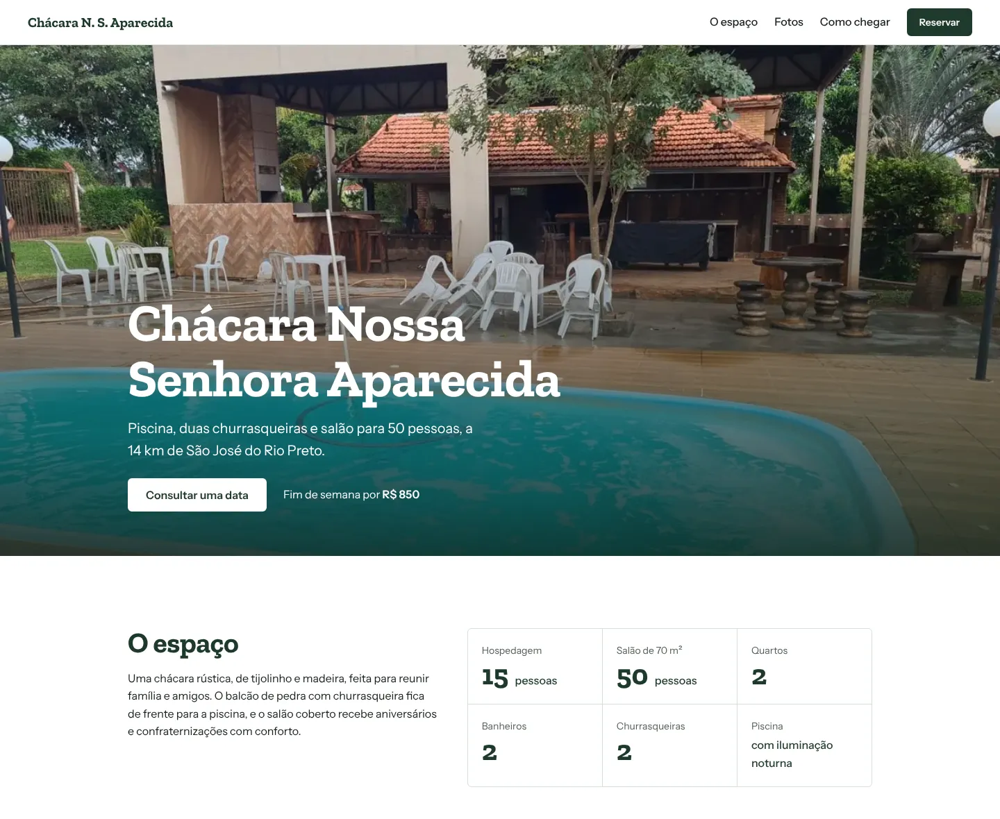
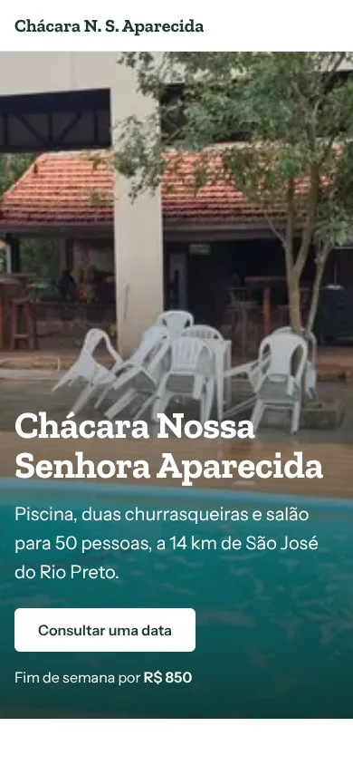

# Chácara Nossa Senhora Aparecida

Site de uma chácara de aluguel para fins de semana e eventos, a 14 km de São José do Rio Preto (SP). O visitante vê o espaço, navega pelas fotos e monta o pedido de reserva, que chega pronto no WhatsApp do proprietário.

**🔗 No ar:** https://site-chacara-tau.vercel.app

<p align="center">
  
  
</p>

## Funcionalidades

- **Galeria com visualização em tela cheia.** Grade que respeita o formato de cada foto e não deixa buracos. Abre em um `<dialog>` nativo, com navegação por setas do teclado, botões e swipe no celular. O foco volta para a foto de origem ao fechar.
- **Reserva pelo WhatsApp.** Formulário com validação (datas no futuro, saída depois da chegada, limite de 50 pessoas) que gera a mensagem formatada e abre a conversa com o proprietário.
- **Botão fixo no celular.** Aparece só quando o topo e o formulário não estão na tela, para não repetir a chamada.
- **Responsivo** do celular ao desktop, com layout próprio para cada faixa de tela.

## Decisões técnicas

| Tema | O que foi feito |
|---|---|
| Performance | Fotos convertidas para WebP em dois tamanhos, servidas com `srcset`/`sizes` e `loading="lazy"`. Foto principal com `preload` e `fetchpriority="high"`. O carregamento inicial caiu de cerca de 2,2 MB para 0,7 MB. |
| Fontes | Zilla Slab e Instrument Sans hospedadas no próprio projeto (`woff2`, `font-display: swap`), sem requisição ao Google Fonts. |
| Acessibilidade | HTML semântico, link "pular para o conteúdo", foco visível, textos alternativos descritivos, mensagens de erro com `role="alert"` e `aria-invalid`, respeito a `prefers-reduced-motion`. |
| SEO | Título e descrição próprios, Open Graph para compartilhamento, dados estruturados `LodgingBusiness` (schema.org), `robots.txt` e `sitemap.xml`. |
| Código | CSS organizado por tokens (cores, tipografia, espaços) e seções; JavaScript em módulo ES, sem dependências, com a galeria encapsulada em uma classe. |

## Estrutura

```
├── index.html
├── assets/
│   ├── css/styles.css
│   ├── js/main.js            # galeria e formulário de reserva
│   ├── fonts/                # fontes self-hosted
│   └── img/
│       ├── src/              # fotos originais
│       └── *-640.webp, *-1280.webp   # geradas pelo script
├── scripts/optimize-images.mjs
├── docs/                     # prints usados neste README
├── robots.txt
└── sitemap.xml
```

## Rodando localmente

```bash
git clone https://github.com/wagnerglongo/site-chacara.git
cd site-chacara
npm install          # só é necessário para regerar as imagens
npm run dev          # abre em http://localhost:3000
```

Para adicionar uma foto nova, coloque o arquivo em `assets/img/src/` e rode:

```bash
npm run images
```

## Tecnologias

HTML5 · CSS3 (Grid, custom properties) · JavaScript (ES Modules) · Node.js + [sharp](https://sharp.pixelplumbing.com/) para otimizar imagens · Vercel

---

Desenvolvido por [Wagner Longo](https://github.com/wagnerglongo).
